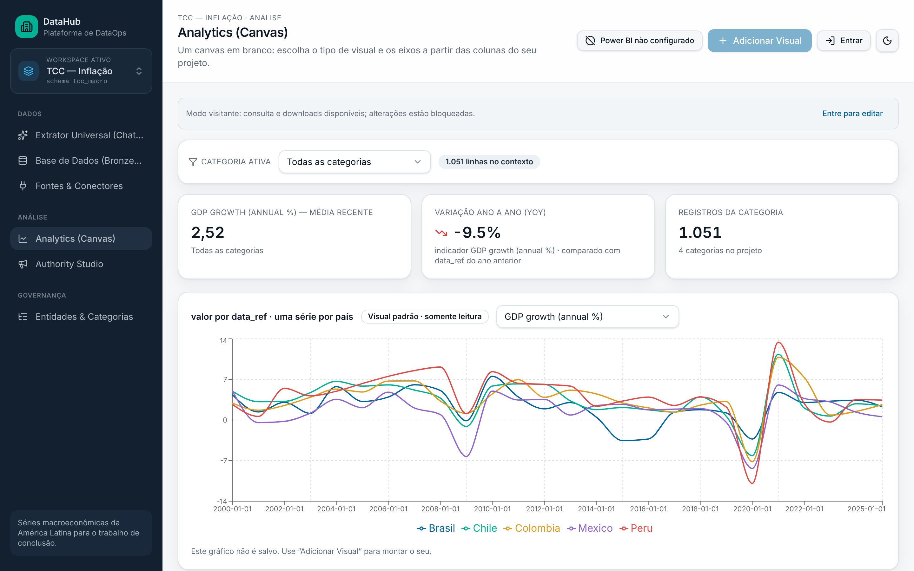

# Projetos · Caio Ribas

Vitrine dos meus projetos de **dados, BI e DataOps** aplicados ao setor público e à macroeconomia. Cada pasta tem README próprio, arquitetura e prints.

Economia (UFPE) · Analista na contabilidade da Secretaria da Fazenda de Caruaru-PE · buscando vaga de **Analista de Dados / BI / Engenheiro de Dados** (Curitiba/PR ou remoto).

---

## ⭐ DataHub · Extrator Universal (ChatOps)

Pedido em linguagem natural → fonte oficial (Banco Mundial, BCB, SICONFI, DATASUS, INEP) → prévia validada → camadas **Bronze / Silver / Gold** no PostgreSQL. Hoje com 1.051 registros reais de inflação, câmbio, PIB e juros de 5 países da América Latina, coletados via n8n com proveniência e hash em cada linha.

`TypeScript` `PostgreSQL` `Supabase` `RLS` `Groq` `n8n` · **[ver projeto →](extrator-universal/README.md)** · **[demo ao vivo](https://datahub-eficiencia-pe.lovable.app)**

---

## Em preparação

| Projeto | O que é | Stack |
|---|---|---|
| **DataOps Intelligence Hub** | Pipeline n8n + Supabase com arquitetura medalhão alimentando dashboards Power BI | n8n · PostgreSQL · Power BI · Groq |
| **Eficiência municipal na primeira infância (PE)** | DEA/Malmquist sobre gastos e resultados em saúde e educação dos municípios pernambucanos | R · DEA · dados SICONFI/DATASUS/INEP |
| **TCC — Câmbio e crescimento na América Latina** | Desalinhamento cambial (índice de Rodrik) e efeitos sobre crescimento e inflação via Panel VAR | R · plm · Panel VAR |

---

**Ferramentas:** Power BI (DAX, Star Schema) · SQL/PostgreSQL · Python (pandas) · R · TypeScript · n8n · Supabase
