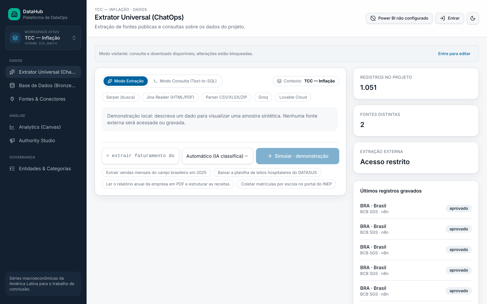
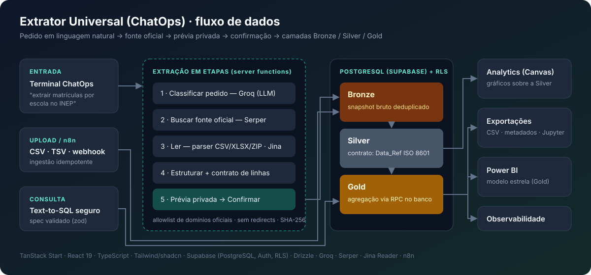
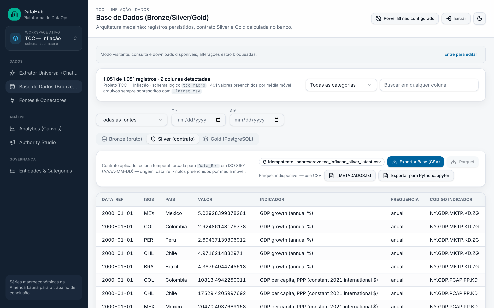
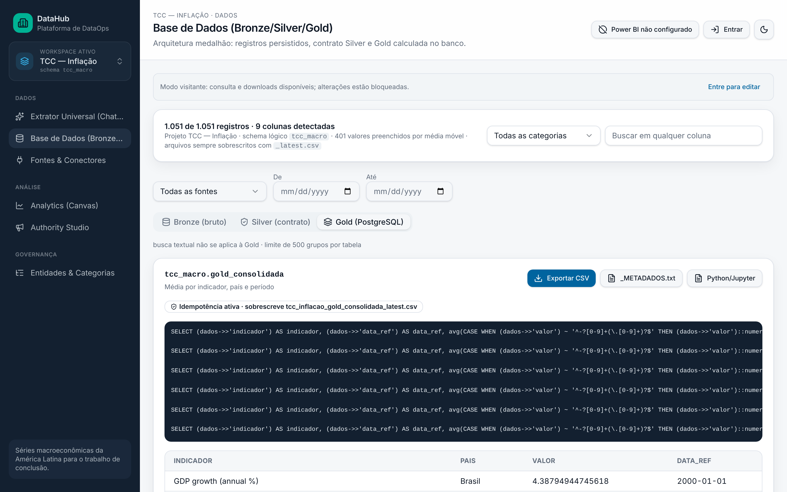
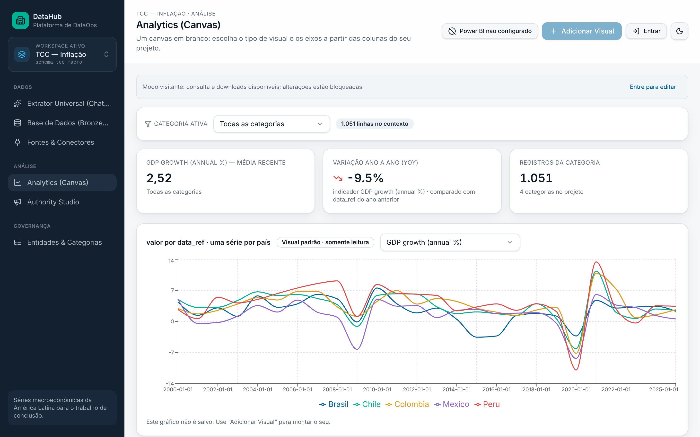
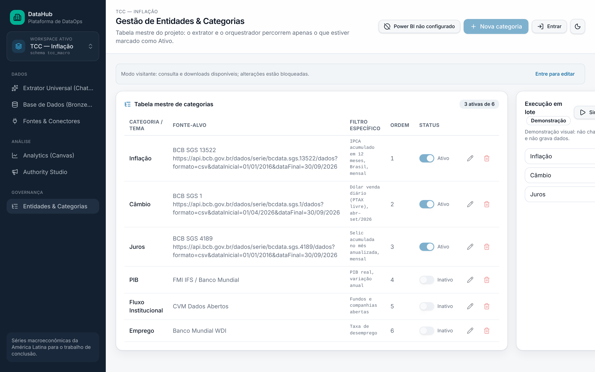

# DataHub · Extrator Universal (ChatOps)

> Plataforma de DataOps que transforma um pedido em linguagem natural ("extrair matrículas em creche por município de PE no INEP") em dados oficiais versionados, validados e prontos para BI — com arquitetura medalhão (Bronze → Silver → Gold) sobre PostgreSQL.

[](https://datahub-eficiencia-pe.lovable.app)




## Por que existe

Pesquisas de eficiência municipal (DEA/Malmquist) dependem de dezenas de bases públicas — SICONFI, DATASUS, INEP, SI-PNI, Atlas/PNUD — cada uma com formato, chave e periodicidade diferentes. O DataHub centraliza essa coleta num único fluxo auditável: **nenhum dado entra na camada analítica sem prévia e confirmação**, e todo indicador de status vem de execuções realmente persistidas no banco, nunca de dados simulados.

Hoje a plataforma roda com dois workspaces isolados:

- **TCC — Inflação** (`tcc_macro`): 1.051 registros reais de inflação, câmbio, PIB e juros de Brasil, Chile, Colômbia, México e Peru (2000–2026), coletados do **Banco Mundial (WDI)** e do **BCB/SGS** por um workflow n8n, com URL de origem, hash do bruto e regras de validação gravados em cada linha. É a base do meu TCC sobre câmbio, crescimento e inflação na América Latina.
- **Eficiência Pública PE** (`eficiencia_pe`): conectores SICONFI, DATASUS/SISVAN, INEP e SI-PNI para o artigo sobre eficiência dos municípios pernambucanos na primeira infância.

## Arquitetura



| Camada | O que acontece |
|---|---|
| **Extração (ChatOps)** | O pedido é classificado por LLM (Groq), uma fonte oficial é localizada (Serper, restrita a `gov.br`, IBGE, DATASUS, BCB…), o arquivo é lido por parsers próprios (CSV/XLSX/ZIP) ou pelo Jina Reader (HTML/PDF) e estruturado. Cada etapa é persistida antes de avançar. |
| **Bronze** | Snapshot bruto imutável, deduplicado por hash SHA-256 dentro do workspace. |
| **Silver** | Contrato de dados aplicado: coluna temporal `Data_Ref` em ISO 8601, chaves IBGE normalizadas (7 → 6 dígitos para cruzar bases municipais). |
| **Gold** | Agregações calculadas no próprio PostgreSQL via RPC `SECURITY INVOKER`, respeitando RLS. |
| **Consumo** | Analytics (Canvas), exportação CSV + metadados + notebook Jupyter, modelo para Power BI e painel de observabilidade. |

## Funcionalidades

- **Modo Extração** — linguagem natural → fonte oficial → prévia privada → *Confirmar / Cancelar*. Resultado parcial nunca é gravado.
- **Modo Consulta (Text-to-SQL seguro)** — a IA não escreve SQL livre: devolve uma especificação validada com `zod`, que é executada por uma função do banco com timeout de 5 s e parâmetros escapados (`%L` / `%I`).
- **Extração em lote por categorias** — tabela mestre de entidades (Saúde/DATASUS, Educação/INEP, …) com fonte-alvo e filtro; o lote reaproveita o mesmo pipeline etapa por etapa.
- **Ingestão via n8n** — endpoint idempotente com Bearer token para orquestração externa.
- **Workspaces isolados** — cada projeto tem schema lógico próprio; visitantes só consultam e baixam.
- **Observabilidade** — falhas, latências e lotes agregados por workspace a partir das execuções gravadas.

## Decisões de engenharia

- **Segurança do download**: apenas HTTPS, allowlist de domínios oficiais, redirects rejeitados e limite de bytes por resposta — o host nunca é escolhido livremente pelo LLM.
- **O LLM não é fonte da verdade**: em arquivos tabulares o parser é autoritativo; se o modelo e o arquivo divergirem na quantidade de linhas, nada é gravado.
- **Fail-closed**: leituras completas percorrem páginas ordenadas com contagem exata; qualquer falha cancela a operação em vez de exportar um recorte silenciosamente truncado.
- **Escrita só no servidor**: todas as mutações passam por server functions autenticadas; o navegador nunca é tratado como fronteira de segurança.

## Telas

| Silver — 1.051 registros com contrato aplicado | Gold — agregação executada no PostgreSQL |
|---|---|
|  |  |
| **Analytics (Canvas)** | **Entidades & Categorias** |
|  |  |

## Stack

TanStack Start · React 19 · TypeScript · Tailwind CSS + shadcn/ui · Supabase (PostgreSQL, Auth, RLS) · Drizzle ORM · Groq · Serper · Jina Reader · n8n · Recharts

## Código e execução

O código-fonte (TanStack Start + Supabase) é desenvolvido no Lovable e será espelhado em um repositório próprio. Para rodar localmente a partir dele:

```bash
bun install        # ou npm install
bun run dev        # ou npm run dev
bun test           # 42 testes sem rede (parser, contrato, paginação, query-spec, gold)
```

Variáveis de ambiente do servidor (extração real):

| Variável | Uso |
|---|---|
| `GROQ_API_KEY` | classificação e estruturação |
| `SERPER_API_KEY` | busca da fonte oficial |
| `JINA_API_KEY` | opcional — leitura de HTML/PDF |
| `INGEST_SECRET` | endpoint de ingestão do n8n |

Sem as chaves, o Extrator roda em **modo demonstração** (amostra sintética, nada é gravado).

## Status

| Sprint | Entrega | Situação |
|---|---|---|
| 0 | Verdade operacional — fim dos status simulados | ✅ |
| 1 | Acesso real, escrita anônima bloqueada, RLS | ✅ implementado |
| 2 | Ingestão idempotente (n8n) | ✅ implementado |
| 3 | Painel de observabilidade por workspace | ✅ implementado |
| 4 | Leitura completa paginada + exportação integral | ✅ |
| 5 | Extração em etapas, lote por categorias, Text-to-SQL, Gold | ✅ implementado |
| — | Validação ponta a ponta com chaves reais | 🔄 em andamento |

## Autor

**Caio Ribas** — Economia (UFPE) · Dados, BI e DataOps aplicados ao setor público
[GitHub](https://github.com/caiooribas20-sys) · [← voltar à vitrine](../README.md)
